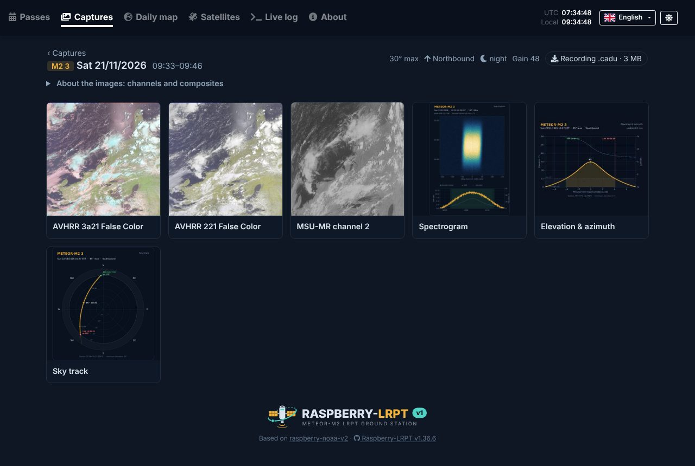

<p align="center">
  <picture>
    <source media="(prefers-color-scheme: dark)" srcset="assets/raspberry-lrpt-dark.svg">
    
  </picture>
</p>

# Raspberry-LRPT v1

A Raspberry Pi ground station for the **METEOR-M2 3** and **METEOR-M2 4** weather satellites (LRPT,
137.9 MHz), decoding with **SatDump 1.2.3**. Built on
[raspberry-noaa-v2](https://github.com/jekhokie/raspberry-noaa-v2) and reworked for METEOR LRPT only.
Made by holifo (SV5QNF).

## What it does

- Schedules every METEOR-M2 3 / M2 4 pass above 15° with `at`, from CelesTrak orbits.
- Records and decodes each pass live with SatDump and makes every composite the satellite's
  channels allow (MSA, AVHRR 221, Natural Color, MCIR, 10.8 µm and 3.9 µm IR, …), annotated with the
  station's details.
- Draws a spectrogram (waterfall, SNR, decoder lock, elevation), a sky track and an
  elevation/azimuth graph for every pass, and keeps the decoded frames (`.cadu`) of the last 5
  passes for offline re-processing.
- Can post each pass to a Discord channel (message, best images, sky track, link to the
  capture), and earlier captures on request; off until you give it a webhook
  ([how](docs/discord.md)).
- Web panel in nine languages (English, Deutsch, Français, Italiano, Español, Ελληνικά, 中文, हिन्दी, العربية), light or dark:
  - **Passes:** next-pass countdown, passes grouped by day, and a live decode panel while a pass
    is recorded (spectrum and waterfall, SNR, Viterbi and frame-sync locks, BER).
  - **Satellites** (`/satellite`): live ground-track map (full screen, zoom), the selected
    satellite's details (position, look angles, next pass, orbit) and the coming passes; tap a
    pass to see its track.
  - **Meteor-M** (`/meteor`): the series at a glance: the satellites working now, every launch and
    the planned ones (M2-5, M2-6, Meteor-MP …), the LRPT signal and the instruments.
  - **Captures:** image grid per pass with a zoomable viewer.
  - **Daily map** (`/daily`): every pass of a day projected onto one map of the region, one for the
    daytime passes and one for the night (SatDump's projection tool), plus a time-lapse of the
    day's passes over Greece. Days fold open and shut.
  - **Live log** (`/log`): system dashboard (CPU, temperature, memory, SDR, disk) and the station log.
  - **Admin** (at `/admin/passes`, password protected): delete passes and captures.
  - Live UTC and local clocks, and the station's version in the footer.

<p align="center">
  
  
</p>

More in [the screenshots](docs/webpanel_screenshots.md).

## Requirements

- Raspberry Pi 4 or 5 (or a 64-bit Debian PC) with **Raspberry Pi OS Bookworm 64-bit**. Trixie is
  not supported yet.
- An RTL-SDR or an Airspy (Mini, R2 or HF+ Discovery) and a 137 MHz antenna such as a QFH.

## Install

```bash
sudo apt install git -y
cd ~ && git clone https://github.com/holifo/raspberry-lrpt raspberry-lrpt
cd raspberry-lrpt
./install_and_upgrade.sh
```

The folder must be `~/raspberry-lrpt`. A first install asks about your station: name, location
(latitude, longitude, altitude), the text on the images, receiver, SD card or SSD, gains, bias tee,
web panel port, admin login and an optional Discord webhook. Enter keeps the value shown. The
answers are saved in `config/settings.local.yml` (not in git), which overrides
`config/settings.yml`; everything else stays in `settings.yml`.
The install then checks the system, runs Ansible, sets up the web panel and schedules the passes,
and ends by printing the web panel's address.

## Update

```bash
cd ~/raspberry-lrpt && git pull && ./install_and_upgrade.sh
```

An upgrade shows the station's settings and asks whether to keep them; answer `n` to go through
the questions again. Questions added in a newer version (such as the Discord webhook) are asked
once. With `-y` it keeps them without asking.

## Re-processing a pass

The decoded frames of the last 5 passes are kept. To decode one again offline and publish it on the
web panel (for example a pass whose live processing failed):

```bash
cd ~/raspberry-lrpt && ./scripts/reprocess_meteor.sh
```

It lists the recordings and asks which to process. `-a` processes every recording that isn't on
the site yet, `all` processes every one, `-l` only lists them, and `./scripts/reprocess_meteor.sh 2`
processes number 2. `./scripts/daily_map.sh --all` redraws the daily maps that can still be redrawn.

## Files and paths

| What | Where |
|---|---|
| Code, database, settings | `~/raspberry-lrpt` (`config/settings.yml`, your answers in `config/settings.local.yml`, `db/panel.db`) |
| Shell settings made by the install | `~/.raspberry-lrpt.conf` |
| Log | `/var/log/raspberry-lrpt/output.log` |
| Images / recordings | `/srv/images`, `/srv/audio/meteor` |
| Web panel | `/var/www/wx-new` |

## More

- **[User guide](docs/USER_GUIDE.md)**: how the station works, every page, commands, settings and
  troubleshooting
- [Screenshots of every view](docs/webpanel_screenshots.md)
- [Changelog](CHANGELOG.md)
- [Annotation](docs/annotation.md), [pruning](docs/pruning.md), [database backups](docs/db_backups.md),
  [TLS for the web panel](docs/tls_webserver.md), [posting to Discord](docs/discord.md),
  [troubleshooting](docs/troubleshooting.md)

## Licence

GPL-3.0, as the project it is based on. See [LICENSE](LICENSE).

## Credits

* **holifo (SV5QNF)**: Raspberry-LRPT v1, the LRPT-only rework of raspberry-noaa-v2.


The NOAA/METEOR image capture community is a group of fantastic, experienced engineers, radio operators, and tinkerers that all contributed in some way, shape,
or form to the success of this repository/framework. Below are some direct contributions and call-outs to the significant efforts made:

* **[jekhokie](https://github.com/jekhokie/raspberry-noaa-v2)**: the project Raspberry-LRPT is built on.
* **[MihajloPi](https://github.com/MihajloPi/raspberry-noaa-v2)**: the project fork Raspberry-LRPT is built on.
* **[haslettj](https://www.instructables.com/member/haslettj/)**: Did the hard initial work and created the post to instruct on how to build the base of this framework.
    * [Instructables](https://www.instructables.com/id/Raspberry-Pi-NOAA-Weather-Satellite-Receiver/) post had much of the content needed to kick this work off.
* **[Nico Rey](https://github.com/reynico)**: Initial creator of the [raspberry-noaa](https://github.com/reynico/raspberry-noaa) starting point for this repository.
* **[flag-icons](https://github.com/lipis/flag-icons)** (MIT): the flags in the language menu.
* **[otti-soft](https://github.com/otti-soft/meteor-m2-lrpt)**: Meteor-M 2 python functionality for image processing.
* **[NateDN10](https://www.instructables.com/member/NateDN10/)**: Came up with the major enhancements to the Meteor-M 2 receiver image processing in "otti-soft"s repo above.
    * [Instructables](https://www.instructables.com/Raspberry-Pi-NOAA-and-Meteor-M-2-Receiver/) post had the details behind creating the advanced functionality.
* **[Dom Robinson](https://github.com/dom-robinson)**: Meteor enhancements, Satvis visualizations, and overall great code written that were incorporated into the repo.
    * Merge of functionality into this repo was partially created using his excellent fork of the original raspberry-noaa repo [here](https://github.com/dom-robinson/raspberry-noaa).
    * Continued pushing the boundaries on the framework capabilities.
* **[Colin Kaminski](https://www.facebook.com/holography)**: MAJOR testing assistance and submission of various enhancements and documentation.
    * Continuous assistance of community members in their search for perfect imagery.
* **[Mohamed Anjum Abdullah](https://www.facebook.com/MohamedAnjum9694/)**: Initial testing of the first release.
* **[Kyle Keen](http://kmkeen.com/rtl-power/)**: Programming a lot of features for our RTL-SDR Drivers.
* **[Pascal P.](https://github.com/Cirromulus)**: Frequency/spectrum analysis test scripts for visualizing the frequency spectrum of the environment.
* **[Socowi's Time Functionality](https://stackoverflow.com/a/50434292)**: Time parser to calculate end date for scanner scripts.
* **[Vince VE3ELB](https://github.com/ve3elb)**: Took on the invaluable task of creating fully working images of RN2 for the PI and maintains [https://qsl.net/ve3elb/RaspiNOAA/](https://qsl.net/ve3elb/RaspiNOAA/).
* **[mihajlo2003petkovic/MihajloPi](https://github.com/mihajlo2003petkovic)**: Integrated MeteorDemod for Meteor decoding and building it via Ansible, and also the awesome SatDump (option satdump_live) for both NOAA and Meteor live decoding. Shrunk and optimised both NOAA and Meteor receive scripts by quite much! Implemented Facebook and Instagram posting scripts and fixed Twitter posting script due to the API 2.0 error. Made the localisation option redundant (automatically handled by the computer itself). Provided support for Airspy, HackRF and SDRPlay devices. Implemented website compression, edited the website landing page and improved the perceived image loading speed by using progressive JPEGs. Created [image](https://drive.google.com/drive/folders/1acaZ78VEROc7BWVtJ82C6qVrccA9CkR6) with Gary Day's help. Removed RTL-FM and GNU Radio and simplified workflow by quite a lot using exclusively SatDump for recording and demodulating signals live to wav/S files, then processing them later with WXtoImg or SatDump for NOAA, and MeteorDemod or SatDump for Meteor.
* **[Silvio I6CBI](https://www.qrz.com/db/I6CBI)**: General testing on Pi and PC running LMDE 5, helped debug WKHTMLTOPDF and integrate SDR Play devices for GNU Radio. Tested MiriSDR.
* **[Nicolas Delestre](https://twitter.com/DELESTRENicola2?t=NHkKPKWMsVQaeNv9vutYMA&s=09)**: General testing on Pi and PC running LMDE 5, lending his Pi and PC to MihajloPi virtually over SSH, VMC and TeamViewer for testing.
* **[Gary Day](https://www.facebook.com/profile.php?id=100068381156913&mibextid=ZbWKwL)**: Helped by lending his Raspberry Pis virtually over SSH, VNC and TeamViewer to MihajloPi for testing and creating an image.
* **[Jérôme jp112sdl](https://github.com/jp112sdl)**: Implemented automatic discarding of Meteor M2-3 night passes since they give no visible image when it's in RGB123 mode.
* **[patrice7560](https://meteo-schaltin.duckdns.org)**: Beta tester, helped in detecting and reporting errors ASAP for debugging.
* **[Richard AI4Y](https://www.qrz.com/db/AI4Y)**: Provided Debian 12 (Bookworm) support for Raspberry Pi, 64-bit Raspberry OS support, discovered the FFMPEG bug when creating spectrograms, solved atrm errors on the website, and several NTP and timezone issues in PHP, developed Verification Tool, Developed In-Situ Upgrade for switching repo's/branches, developed RN2 Utilities for backup/restore/stage, uninstall and upgrading, general warning cleanup of scripts, Made 32-bit wxtoimg run on 64-bit Debian, creates satdump/predict DEB files for armhf & arm64, general alpha and beta testing.
