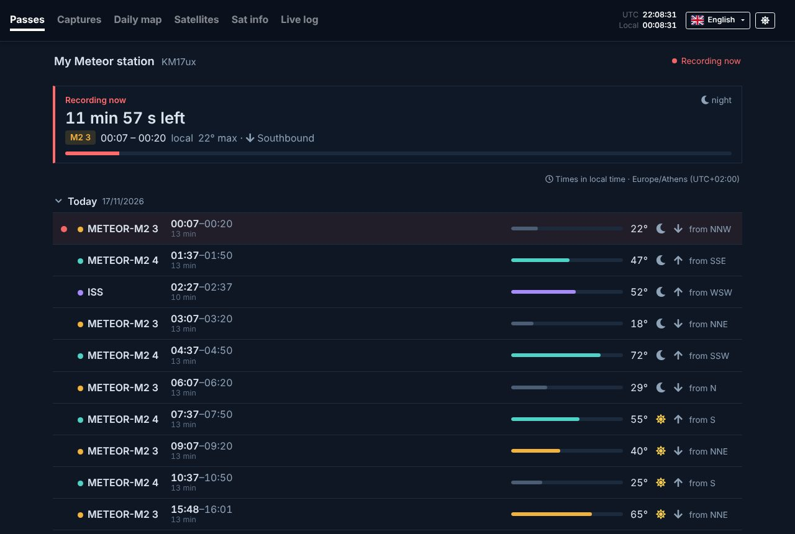

<p align="center">
  <picture>
    <source media="(prefers-color-scheme: dark)" srcset="assets/raspberry-lrpt-dark.svg">
    
  </picture>
</p>

# Raspberry-LRPT v1

A Raspberry Pi ground station for the **METEOR-M2 3** and **METEOR-M2 4** weather satellites (LRPT,
137.9 MHz), decoding with **SatDump 1.2.3**. Built on
[raspberry-noaa-v2](https://github.com/jekhokie/raspberry-noaa-v2) and reworked for METEOR LRPT.
**Extra:** between Meteor passes it also catches the slow-scan TV pictures the **ISS** sends during
ARISS events, and between events the APRS stations it relays, live on a map. Made by holifo (SV5QNF).

## What it does

- Schedules every METEOR-M2 3 / M2 4 pass above 15° with `at`, from CelesTrak orbits (the SatNOGS DB as the backup).
- Records and decodes each pass live with SatDump and makes every composite the satellite's
  channels allow (MSA, AVHRR 221, Natural Color, MCIR, 10.8 µm and 3.9 µm IR, …), annotated with the
  station's details.
- Draws a spectrogram (waterfall, SNR, decoder lock, elevation), a sky track and an
  elevation/azimuth graph for every pass, and keeps the decoded frames (`.cadu`) of the last 5
  passes for offline re-processing.
- Can post each pass to a Discord channel (message, best images, sky track, link to the
  capture), and earlier captures on request; off until you give it a webhook
  ([how](docs/discord.md)).
- Web panel in nine languages (English, Deutsch, Français, Italiano, Español, Ελληνικά, 中文, हिन्दी, العربية), light or dark:
  - **Passes:** next-pass countdown, passes grouped by day, and a live decode panel while a pass
    is recorded (spectrum and waterfall, SNR, Viterbi and frame-sync locks, BER).
  - **Satellites** (`/satellite`): live ground-track map (full screen, zoom), the selected
    satellite's details (position, look angles, next pass, orbit) and the coming passes; tap a
    pass to see its track.
  - **Sat info** (`/meteor`): the Meteor-M series at a glance (the satellites working now, every
    launch and the planned ones, the LRPT signal and the instruments) and, as an extra, the ISS:
    its orbit, its amateur radio frequencies and the year's ARISS SSTV events.
  - **Captures:** image grid per pass with a zoomable viewer.
  - **Daily map** (`/daily`): every pass of a day projected onto one map of the region, one for the
    daytime passes and one for the night (SatDump's projection tool), plus a time-lapse of the
    day's passes over Greece. Days fold open and shut.
  - **Live log** (`/log`): system dashboard (CPU, temperature, memory, SDR, disk) and the station log.
  - **Admin** (at `/admin/passes`, password protected): delete passes and captures.
  - Live UTC and local clocks, and the station's version in the footer.

### Extra: ISS SSTV pictures and APRS

A few times a year, during ARISS events, the International Space Station sends slow-scan TV
pictures. Between Meteor passes the station records the ISS's passes and decodes them:

- **Frequency:** 437.550 MHz FM by default (ARISS's 2026 events, Robot 36), or 145.800 MHz (PD120);
  the decoder finds the mode itself and copes with weak, drifting signals.
- **Meteor always comes first:** an overlapping ISS pass isn't recorded, and a Meteor pass stops an
  ISS recording that is still running.
- **On the site:** violet ISS cards on the Captures page (filter chip **ISS**), the ISS on the
  Satellites map, and Discord posts with the pictures. Passes with no pictures leave no trace.
- **Between events, APRS:** outside the event dates it records the ISS's APRS digipeater
  (437.825 MHz since 2026, decoded with Dire Wolf): the stations heard show up live on the Satellites map,
  and each pass gets a page with a map and a list of the stations (`iss_aprs`).
- RTL-SDR only; off by default, with an on/off switch on Admin > Passes (`iss_sstv`). See [ISS SSTV](docs/iss_sstv.md).

<p align="center">
  
  
</p>

More in [the screenshots](docs/webpanel_screenshots.md).

## Requirements

- Raspberry Pi 4 or 5 (or a 64-bit Debian PC) with **Raspberry Pi OS Bookworm or Trixie, 64-bit**.
  Both have a ready SatDump package ([Trixie](docs/trixie.md)).
- A receiver: an RTL-SDR, Airspy (Mini, R2 or HF+ Discovery), HackRF One, SDRplay RSP or MSi2500
  (MiriSDR) receiver ([receivers](docs/receivers.md)), and a 137 MHz antenna such as a QFH.

## Install

```bash
sudo apt install git -y
cd ~ && git clone https://github.com/holifo/raspberry-lrpt raspberry-lrpt
cd raspberry-lrpt
./install_and_upgrade.sh
```

The folder must be `~/raspberry-lrpt`. A first install asks about your station: name, location
(latitude, longitude, altitude), the text on the images, receiver (from a list; the install sets up
its drivers), SD card or SSD, gains, bias tee, web panel port, admin login and an optional Discord
webhook. Enter keeps the value shown. The
answers are saved in `config/settings.local.yml` (not in git), which overrides
`config/settings.yml`; everything else stays in `settings.yml`.
The install then checks the system, runs Ansible, sets up the web panel and schedules the passes,
and ends by printing the web panel's address.

## Coming from raspberry-noaa-v2

A raspberry-noaa-v2 station keeps its settings and Meteor captures:

```bash
cd ~ && git clone https://github.com/holifo/raspberry-lrpt raspberry-lrpt
~/raspberry-lrpt/scripts/tools/upgrade_from_noaa_v2.sh
```

It needs Bookworm or Trixie, 64-bit; an older system saves the station to a file first
(`--export`) and loads it on the new one (`--import`). See
[upgrading from raspberry-noaa-v2](docs/upgrade_from_noaa_v2.md).

## Update

```bash
cd ~/raspberry-lrpt && git pull && ./install_and_upgrade.sh
```

An upgrade shows the station's settings and asks whether to keep them; answer `n` to go through
the questions again. Questions added in a newer version (such as the Discord webhook) are asked
once. With `-y` it keeps them without asking.

## Re-processing a pass

The decoded frames of the last 5 passes are kept. To decode one again offline and publish it on the
web panel (for example a pass whose live processing failed):

```bash
cd ~/raspberry-lrpt && ./scripts/reprocess_meteor.sh
```

It lists the recordings and asks which to process. `-a` processes every recording that isn't on
the site yet, `all` processes every one, `-l` only lists them, and `./scripts/reprocess_meteor.sh 2`
processes number 2. `./scripts/daily_map.sh --all` redraws the daily maps that can still be redrawn.

## Files and paths

| What | Where |
|---|---|
| Code, database, settings | `~/raspberry-lrpt` (`config/settings.yml`, your answers in `config/settings.local.yml`, `db/panel.db`) |
| Shell settings made by the install | `~/.raspberry-lrpt.conf` |
| Log | `/var/log/raspberry-lrpt/output.log` |
| Images / recordings | `/srv/images`, `/srv/audio/meteor` |
| Web panel | `/var/www/wx-new` |

## More

- **[User guide](docs/USER_GUIDE.md)**: how the station works, every page, commands, settings and
  troubleshooting
- [Screenshots of every view](docs/webpanel_screenshots.md)
- [Changelog](CHANGELOG.md)
- [Annotation](docs/annotation.md), [pruning](docs/pruning.md), [database backups](docs/db_backups.md),
  [TLS for the web panel](docs/tls_webserver.md), [posting to Discord](docs/discord.md),
  [receivers](docs/receivers.md), [upgrading from raspberry-noaa-v2](docs/upgrade_from_noaa_v2.md),
  [Trixie](docs/trixie.md), [the image label](docs/annotation.md), [ISS SSTV](docs/iss_sstv.md),
  [troubleshooting](docs/troubleshooting.md)

## Licence

GPL-3.0, as the project it is based on. See [LICENSE](LICENSE).

## Credits

* **holifo (SV5QNF)**: Raspberry-LRPT v1, the LRPT-only rework of raspberry-noaa-v2. Much of the code,
  documentation and translations was written with the help of AI ([Claude](https://www.anthropic.com/claude)
  by Anthropic), to holifo's instructions and tested on a working station.

### The projects it grew from

* **[jekhokie](https://github.com/jekhokie/raspberry-noaa-v2)**: raspberry-noaa-v2, the project Raspberry-LRPT is built on.
* **[MihajloPi](https://github.com/MihajloPi/raspberry-noaa-v2)**: the raspberry-noaa-v2 fork it started from. Brought in SatDump
  for live Meteor decoding and support for Airspy, HackRF and SDRplay receivers.
* **[Richard AI4Y](https://www.qrz.com/db/AI4Y)**: Debian 12 (Bookworm) and 64-bit Raspberry Pi OS support, the verification
  tool, the backup/restore and uninstall utilities, and SatDump/predict packages for the Pi.
* **[Dom Robinson](https://github.com/dom-robinson)**: Meteor enhancements in raspberry-noaa-v2.
* **[Nico Rey](https://github.com/reynico/raspberry-noaa)** and **[haslettj](https://www.instructables.com/id/Raspberry-Pi-NOAA-Weather-Satellite-Receiver/)**:
  raspberry-noaa and the original Raspberry Pi weather-satellite receiver guide that started it all.
* **[Silvio I6CBI](https://www.qrz.com/db/I6CBI)**: testing of the SDRplay and MiriSDR receivers.

### Reception testing scripts (`scripts/testing/`)

* **[Kyle Keen](http://kmkeen.com/rtl-power/)**: rtl_power and the heat map behind the spectrum scans.
* **[Pascal P.](https://github.com/Cirromulus)**: the frequency/spectrum scan scripts.
* **[Socowi](https://stackoverflow.com/a/50434292)**: the time parser in `t2sec.sh`.

### Software it uses

* **[SatDump](https://github.com/SatDump/SatDump)**: records and decodes the Meteor LRPT passes and makes the images and maps.
* **[SatNOGS DB](https://db.satnogs.org)** (Libre Space Foundation): the backup source of orbits (TLEs) when CelesTrak can't be reached.
* **[predict](https://github.com/kd2bd/predict)** by John Magliacane, KD2BD: pass predictions.
* **[RTL-SDR Blog drivers](https://github.com/rtlsdrblog/rtl-sdr-blog)**: the RTL-SDR driver the install builds.
* **[d3](https://d3js.org)** and **[satellite.js](https://github.com/shashwatak/satellite-js)**: the live map on the Satellites page.
* **[sstv](https://github.com/colaclanth/sstv)**: SSTV decoding for the ISS extra (besides the station's own decoder).
* **[Dire Wolf](https://github.com/wb2osz/direwolf)** by John Langner, WB2OSZ: decodes the ISS's APRS packets.
* **[flag-icons](https://github.com/lipis/flag-icons)** (MIT): the flags in the language menu.
