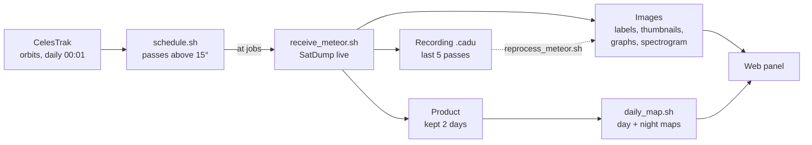
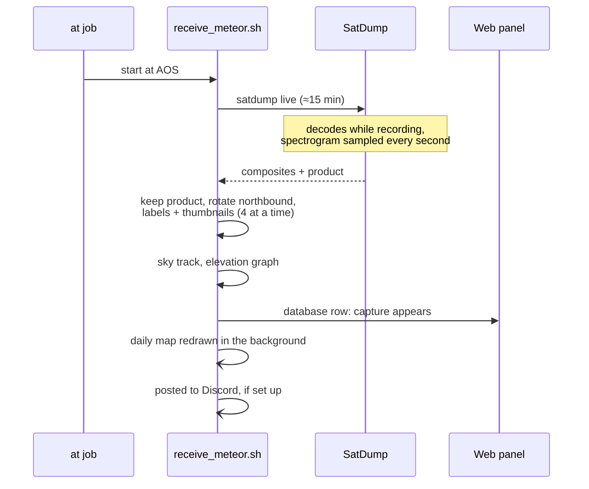
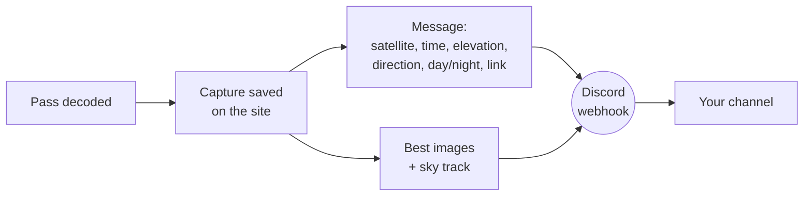

# Raspberry-LRPT v1 · User guide

A guide to running the station day to day: what it does on its own, what each page of the web
panel shows, the commands you will use, the settings worth knowing, and what to do when something
goes wrong. For installing, see the [README](../README.md).

- [How the station works](#how-the-station-works)
- [The life of one pass](#the-life-of-one-pass)
- [The web panel](#the-web-panel)
- [The daily map](#the-daily-map)
- [Posting to Discord](#posting-to-discord)
- [Commands](#commands)
- [Settings worth knowing](#settings-worth-knowing)
- [Troubleshooting](#troubleshooting)
- [Files and paths](#files-and-paths)

---

## How the station works

Everything runs by itself. Once a day the station downloads fresh orbits and schedules the passes;
each pass is then recorded, decoded and published without anyone touching it.



| Piece | What it does |
|---|---|
| **Orbits** | `schedule.sh` downloads METEOR-M2 3 and M2 4 orbits (TLEs) from CelesTrak every night. If CelesTrak fails, it keeps yesterday's. |
| **Scheduling** | Every pass above 15° for the next 7 days, day and night, as `at` jobs. Overlapping passes: the better one is kept. |
| **Recording** | SatDump 1.2.3 records and decodes live from the RTL-SDR (`satdump live meteor_m2-x_lrpt`). |
| **Images** | Every composite the satellite's channels allow, each with the station label, plus thumbnails, a sky track, an elevation/azimuth graph and a spectrogram. |
| **Daily map** | After each pass, the day's passes are joined onto one map (see [below](#the-daily-map)). |
| **Web panel** | nginx + PHP on the Pi; public at the station's address. |

## The life of one pass



After the pass, SatDump builds its composites (a few minutes), then the station labels and
thumbnails the images, one per CPU core. The capture appears on the site when that is done; the
day's maps follow a little later.

**Day or night:** a pass is "day" when the sun is above the horizon at the station. Day captures
show visible-light composites first (MSA, AVHRR 221, Natural Color), night captures show infrared
first (MCIR, 10.8 µm, 3.9 µm). A satellite only sends three of its six channels, so a pass only has
the composites those channels allow.

## The web panel

| Page | Address | What it shows |
|---|---|---|
| **Passes** | `/passes` | Station bar (name, grid square, Recording / Waiting), next pass countdown, live decode panel while recording, passes grouped by day |
| **Satellites** | `/satellite` | Live map of both satellites, the selected one's details, the coming passes |
| **Meteor-M** | `/meteor` | The series: satellites working now, every launch and plan, the LRPT signal, the instruments |
| **Captures** | `/captures` | Every capture as a card, grouped by day; "About the images" explains the channels and every image type |
| **One capture** | click a card | Pass details, every image (zoomable viewer), graphs, spectrogram, recording download |
| **Daily map** | `/daily` | One map per day of all day passes, one of all night passes, and the day's time-lapse |
| **Live log** | `/log` | CPU, temperature, memory, SDR, disks, next pass, and the station log live |
| **Admin** | `/admin/passes` (type it) | Delete passes and captures; needs the admin password |

**On every page:** the language menu (flag, top right: English, Deutsch, Français, Italiano,
Español, Ελληνικά, 中文, हिन्दी, العربية), the moon / sun button for dark mode, and the UTC and local
clocks. The browser remembers your language and theme. The footer shows the station's version.

**Passes page**

- **Tap a pass** to open it on the Satellites tab with its track drawn.
- **Live decode** (while a pass is recorded, under the next-pass card), updated every second
  from SatDump: the spectrum (±160 kHz, the LRPT band shaded, green once locked) with a scrolling
  waterfall; the SNR and its peak; the **Viterbi** and **frame sync** lights (green = the decoder
  is locked and frames are coming in); the Viterbi BER (lower is better, under about 0.17 when
  locked); Reed-Solomon corrections; the frequency offset; and a graph of the SNR through the pass,
  shaded where frames were synced. The constellation is **estimated from the SNR**: SatDump 1.2.3
  keeps its real one to itself. After LOS it says the images are being decoded, then hides.
- **Pass list icons:**

  | Icon | Meaning |
  |---|---|
  | ✓ | Captured: tap it to open the capture |
  | red dot | Recording now |
  | ✗ | Missed |
  | ⚠ | Clashes with another pass |
  | ⊘ | Not scheduled |
  | sun / moon | Day or night pass |
  | grey bar | Below 30° (weak) |

**Satellites page**

- **Map:** the buttons on the map: **+ / −** zoom around the station, the **target** shows the
  whole world, the **pin** zooms to the station's reception area, and the last one is **full
  screen**. Double-click zooms in; Ctrl + wheel zooms with a mouse; pinch on a phone.
- **While a satellite is in range** a panel next to it shows how far through the pass it is,
  its elevation and the time left.
- **Details** of the selected satellite (M2 3 / M2 4 tabs, or the pass you tapped): position,
  altitude, speed, direction and elevation from the station, distance, sunlight or shadow, the
  current or next pass, and its orbit (number, period, inclination, height, IDs, downlink, age of
  the orbit data).
- **Coming passes:** tap one to draw its track with its AOS and LOS times.

**Meteor-M page:** the satellites working now, a timeline of every launch and the planned ones,
the LRPT signal and the instruments, with the sources and the date they were checked.

**Captures:** tap any image to open the viewer: zoom with the buttons, the wheel or a pinch, move
with a drag, and step through the pass's images with the arrows.

**Live log:** the log colours lines by level (red errors, amber warnings, blue info, grey debug);
the chips above it filter by level, and the box filters by text. **Follow** keeps the newest line
in view.

## The daily map

Every pass of a day is projected onto one map of the region around the station, newest pass on
top. There are two maps a day:

| Map | Composite | Channels | What you see |
|---|---|---|---|
| **Day** | AVHRR 221 false colour | 2, 2, 1 (0.8, 0.8, 0.6 µm) | Land yellow and brown, vegetation brighter, sea dark blue, clouds, snow and ice white |
| **Night** | 3.9 µm shortwave IR, inverted | 4 (3.8 µm) | Cold cloud tops bright, warm land and sea dark; works without sunlight |

```
  7°W                                              63°E
61°N ┌──────────────────────────────────────────────┐
     │  Scandinavia                     Urals       │
     │        Europe                                │
     │                 ● station          Caspian   │   2800 × 2000 px
     │  Morocco          Mediterranean              │   0.025° per pixel
     │            Sahara             Arabia         │   ≈ 2.8 km per pixel
11°N └──────────────────────────────────────────────┘
```

- **When:** after every pass, in the background at low priority. A day's map is redrawn with
  each new pass, so it fills in during the day.
- **On the page:** each card shows the composite, the channels and the time span of its passes;
  each day shows the area, the scale and when it was last redrawn. The chips under a day link to
  the captures the maps are made of. **About these maps** at the top explains the colours. Days
  fold open and shut (the newest is open); a folded day shows its pass count and thumbnails.
- **Time-lapse:** each day also gets a video of its passes from 00:00 to 24:00 (local time) over
  `animation_area` (Greece), one frame per pass, all in 3.9 µm infrared so day and night frames
  look alike. It is redrawn with the day's maps. Its frames are kept a week, so a day can be
  rebuilt (`./scripts/animation.sh <date>`) after its products are gone.
- **Its data:** each pass's SatDump product (raw channels, line times, orbit) is kept for
  **2 days** in `/srv/audio/meteor/products`. A day older than that can't be redrawn, but its maps
  stay.
- **Passes left out:** a pass with no orbit or corrupt line times (no map drawn) is not added.
- **Turn it off:** `daily_map: false` in `config/settings.yml`, then run the install.

## Posting to Discord

The station can post every pass that made images to a Discord channel. It is off until you give it
a webhook.



**Turn it on**

1. In Discord: open the channel, then **Edit Channel → Integrations → Webhooks → New Webhook →
   Copy Webhook URL**.
2. On the Pi: `cd ~/raspberry-lrpt && ./install_and_upgrade.sh`. An upgrade asks the Discord
   question once; later, answer `n` to "Keep these settings?" to reach it. Paste the URL, then give
   the web panel's address as seen from the internet (for the link in each post) or `-` for none.
3. Check it: `./scripts/push_discord.sh --test` posts a test message.

**What gets posted:** one message per pass, after the capture is on the site:

- satellite, local and UTC time, maximum elevation, direction, day or night, length
- station name and a link to the capture's page
- the best images: `discord_images` (default 2), chosen in the order of the day or night
  thumbnail list, then the image list
- the sky track (`discord_sky_track`)

Images over Discord's 10 MB limit are sent smaller. Only new passes are posted by themselves.

**Post earlier captures:** `./scripts/discord_post.sh -l` lists the newest 20 with their numbers.
Then post some with `./scripts/discord_post.sh 123 124`, the newest few with `--last 3`, or a whole
day with `--today` or `--day 2026-11-14`. It asks before posting (`-y` doesn't).

**Keep the webhook private:** anyone who has it can post in your channel. The install keeps it in
`config/settings.local.yml` (not in git); the log never shows it. If it leaks, delete the webhook in
Discord and make a new one.

**Turn it off:** run the install, answer `n` to "Keep these settings?" and `-` to the webhook
question.

More in [discord.md](discord.md).

## Commands

Run them on the Pi as your normal user (not with `sudo`).

| To… | Run |
|---|---|
| Update the station | `cd ~/raspberry-lrpt && git pull && ./install_and_upgrade.sh` |
| Update scripts only (no install needed) | `cd ~/raspberry-lrpt && git pull` |
| Change your station's answers | `./install_and_upgrade.sh`, answer `n` to "Keep these settings?" |
| See the scheduled passes (local time) | `atq \| sort -k6,6n -k3,3M -k4,4n -k5,5` |
| Download orbits and reschedule now | `./scripts/schedule.sh -t` |
| List the kept recordings | `./scripts/reprocess_meteor.sh -l` |
| Re-process recording number 2 | `./scripts/reprocess_meteor.sh 2` |
| Re-process all of them | `./scripts/reprocess_meteor.sh -y all` |
| Re-process the ones not on the site | `./scripts/reprocess_meteor.sh -a` |
| Redraw a day's maps | `./scripts/daily_map.sh 2026-11-13` |
| Redraw every day that can be | `./scripts/daily_map.sh --all` |
| Make the time-lapse now | `./scripts/animation.sh` for today, `./scripts/animation.sh 2026-11-14` for one day, `--all` for every day it can (add `--redo` after changing the area) |
| Send a test post to Discord | `./scripts/push_discord.sh --test` |
| Post earlier captures to Discord | `./scripts/discord_post.sh -l` to list them, then `./scripts/discord_post.sh 123`, `--last 3` or `--today` |
| Follow the log | `tail -f /var/log/raspberry-lrpt/output.log` (or open `/log`) |
| Check the orbit data | `grep -c 59051 ~/.config/satdump/satdump_tles.txt` (should be 1 or more) |

**Re-processing** decodes a kept recording again, offline, and replaces the capture on the site
(new images, labels, graphs and a redrawn day map). Use it when a live pass failed after
recording, or after an update that changes the images. `-y` skips the "replace?" question.

## Settings worth knowing

Settings live in `config/settings.yml`; your install answers (station, location, receiver, gains,
web login, Discord webhook) are in `config/settings.local.yml` and win over it. After changing either, run
`./install_and_upgrade.sh`.

| Setting | Default | What it does |
|---|---|---|
| `meteor_m2_3_sat_min_elevation`, `meteor_m2_4_sat_min_elevation` | 15 | Lowest pass elevation scheduled (suits a QFH) |
| `days_to_schedule_passes` | 7 | How far ahead passes are scheduled |
| `keep_recordings` | 5 | How many `.cadu` recordings to keep (0 = none) |
| `daily_map` | true | The daily map page and its maps |
| `map_capitals` | true | Capital cities' names on the map images and the daily map |
| `enable_animation` | true | A time-lapse of each day (00:00–24:00) with that day's maps on the Daily map page |
| `animation_area` | "19 30 34 42" | Time-lapse area: west east south north (degrees) |
| `map_projection` | equal_earth | Daily maps and time-lapse: `equal_earth` (true areas) or `equirectangular` |
| `storage` | sd | What the Pi runs from, asked by the install. `sd`: each pass is decoded on a RAM disk to spare the SD card. `ssd`: no RAM disk |
| `delete_older_than_n` | 30 | Captures older than this many days are deleted |
| `flip_meteor_image` | true | Turn northbound passes the right way up |
| `annotation_width_percent` | 50 | Width of the station label, as a share of the image |
| `meteor_daytime_enhancements` / `…nighttime…` | (lists) | Order of the images on a capture's page |
| `meteor_daytime_thumbnail` / `…nighttime…` | MSA / MCIR | Which image becomes the capture's card |
| `produce_spectrogram` | true | The spectrogram per pass |
| `station_title` | | Name in the station bar |
| `lang_setting` | en | Language for visitors who haven't picked one |
| `discord_webhook` | | Post each pass to Discord: asked by the install, kept in `settings.local.yml`; empty = off ([Discord](discord.md)) |
| `discord_site_url`, `discord_images`, `discord_sky_track` | , 2, true | Link to the capture in the post, how many images, the sky track |

`PARALLEL_JOBS` in `~/.raspberry-lrpt.conf` (default: the number of CPU cores) limits how many
images or map layers are processed at once; set it to 2 if the Pi ever runs short of memory.

## Troubleshooting

| What you see | Why | What to do |
|---|---|---|
| A capture has no map overlay, no MCIR, no projections; the log says `No Ephemeris or TLE` | SatDump had no orbit (CelesTrak was down) | Check the orbit data (see [Commands](#commands)); `./scripts/schedule.sh -t`, then re-process the pass |
| Coastlines over the wrong part of the world | The recording's line times are corrupt (noisy frames) | Nothing to fix; since v1.1.2 such passes keep their images without a map |
| A night pass is grey noise in AVHRR 221 | Visible channels see nothing at night | Look at the 3.9 µm image |
| A pass is mostly noise at a good elevation | The satellite sent corrupt data | Watch the next passes of that satellite |
| No pass appears after its time | Missed or still processing | Open `/log`; red lines show what went wrong |
| The passes map shows no satellites | No orbit data in the web panel | `./scripts/schedule.sh -t` |
| The daily map is missing a pass | That pass had no map (see above), or its product is over 2 days old | Re-process it within 2 days |
| `git pull` asks for a password or says 403 | The repo is private | Use the deploy key or access token set up for the Pi |
| No Discord post after a pass | No webhook, a wrong one, or Discord refused it | `./scripts/push_discord.sh --test`; the log says `Discord post failed (HTTP …)` with Discord's reason. 401/404: make a new webhook and give it to the install |
| The install stops at step 1 | A capture is running, or a tracked file was edited on the Pi | Wait for the pass; `git status` shows the edited file |

More in [troubleshooting.md](troubleshooting.md).

## Files and paths

| What | Where |
|---|---|
| Code, database, settings | `~/raspberry-lrpt` (`config/`, `db/panel.db`) |
| Shell settings made by the install | `~/.raspberry-lrpt.conf` |
| Log | `/var/log/raspberry-lrpt/output.log` |
| Images and thumbnails | `/srv/images`, `/srv/images/thumb` |
| Daily maps | `/srv/images/daily` (`<date>-day.jpg`, `<date>-night.jpg`, `<date>.json`) |
| Daily time-lapses | `/srv/images/daily/timelapse` (`<date>.webm`, `.mp4`, `.jpg`, `.json`); frames in `/srv/images/animation/frames` (7 days) |
| Recordings | `/srv/audio/meteor/*.cadu` |
| Products for the daily map | `/srv/audio/meteor/products` (2 days) |
| Orbits | `~/raspberry-lrpt/tmp/orbit.tle`, `~/.config/satdump/satdump_tles.txt` |
| Web panel | `/var/www/wx-new` |
